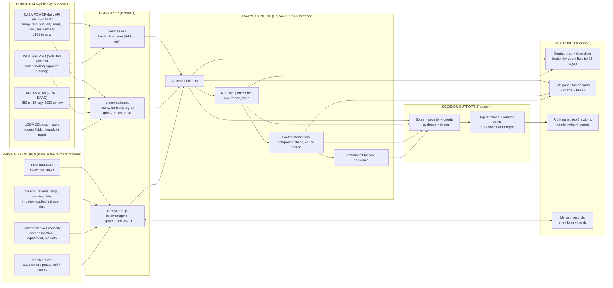
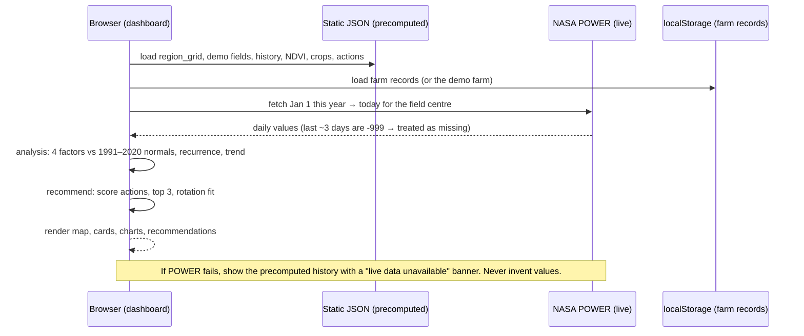
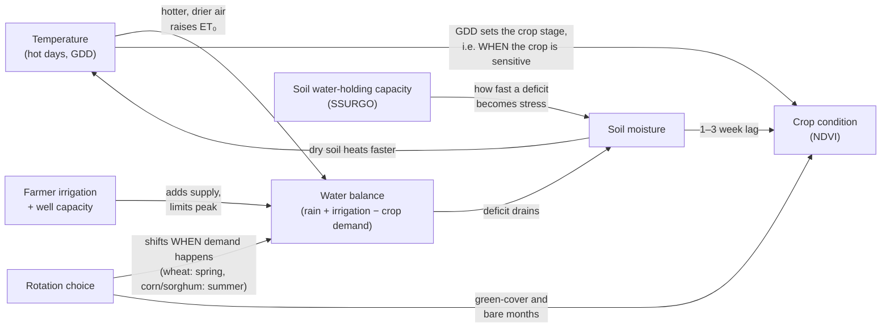

# Kimchi build plan: farm risk and rotation dashboard

**Written Nov 15, 2026, 5:45 pm Eastern. Submission deadline: Nov 15, 11:59 pm.** The time zone of the deadline was not confirmed. The checkpoints below assume Eastern time. If your event uses an earlier zone, move every checkpoint earlier by the difference.

This file replaces the earlier "evidence viewer only" direction. Each teammate's AI prompt is in [`team/`](team/). Give your AI this file **and** your own prompt.

| Person | Prompt | Owns |
|---|---|---|
| 1 | [team/P1_data_backend.md](team/P1_data_backend.md) | Live NASA and USDA fetchers, precomputed history files, the farmer-data store |
| 2 | [team/P2_analysis_engine.md](team/P2_analysis_engine.md) | All calculations: the four factors, normals, recurrence, trends, rotation fit |
| 3 | [team/P3_dashboard.md](team/P3_dashboard.md) | The web app: map, time slider, left and right panels, farm-records screen, public URL |
| 4 | [team/P4_recommendations_submission.md](team/P4_recommendations_submission.md) | Crop and action libraries, top-3 recommendation scoring, season report, write-up and video |

---

## 1. What we are building and why

**Official challenge: "Field Shift: Adapting Farms with NASA Data."** The objective, quoted from the team's Google Doc:

> Combine NASA Earth observations with local agricultural information to create an app, model, interactive map, or other decision-support tool. The goal is to help farmers explore crop-rotation options that may improve soil health and strengthen resilience to changing weather and water conditions. [...] You may compare at least three rotation strategies, including the existing rotation. For each strategy, you may explain why it was suggested, what evidence supports it, what benefits it may offer, where information gaps exist, and any risks that would need local review. [...] The intended outcome is a supportive tool [...] that does not replace farmer judgment or local agricultural expertise.

**Our product, in one sentence:** a map-based dashboard where a farmer draws or selects their fields. It pulls live and historical NASA data for four factors and shows where each risk is, how severe it is, and how often it recurs. It combines that with the farmer's own season records and suggests the top 3 actions and rotation options, with evidence for each.

**Demo story:** an irrigated corn field in Sheridan 6, western Kansas. The farm sits on the declining Ogallala aquifer and has a limited water allocation. The farmer asks: *"With limited water and hotter summers, should I keep continuous corn, or switch to corn–sorghum or corn–wheat? What should I do this season?"*

## 2. Decisions already made (do not reopen tonight)

| Topic | Decision |
|---|---|
| Factors analysed | **1. Water balance. 2. Temperature (extremes + accumulated heat). 3. Soil moisture. 4. Crop condition.** Crop rotation is the *decision* these factors feed, not a factor. |
| Required output | Rotation comparison (current rotation plus at least 2 alternatives), plus a **what-if** mode where the farmer picks any sequence from the crop library. |
| Recommendations | **Top 3 actions, ranked by a visible rule-based score**: severity × farmer priority × evidence strength × timing. Every card shows its score breakdown, live and historical evidence, benefits, risks, information gaps, and "check with a local expert". There is **no machine-learning model** and no "best/optimal rotation" label. |
| Farmer data | Stored **in the farmer's browser** (localStorage) with **Export/Import as JSON**. There are no accounts and no server database, and farmer data never goes to GitHub. |
| Map time slider | **Two scales.** Region view: NASA POWER grid cells across western Kansas, animated **by year from 1981 to now**. Field view: MODIS satellite greenness (NDVI) pixels around the field, animated **by 16-day period**. |
| Fields | The farmer can **draw any field** in the contiguous US, and the 3 demo fields (`fld01`–`fld03`) are preloaded. |
| Live data | The browser calls NASA POWER and USDA Soil Data Access **directly**; both send `Access-Control-Allow-Origin: *`, checked Nov 15. Long history is precomputed to static JSON for speed and so the demo works offline. |
| Backend | Precompute scripts run in Node, and the app is static. There is no server to run tonight, and the static output counts as our "small backend". |
| Deferred | OpenET, GRACE-FO, SMAP, GPM IMERG, ECOSTRESS, PRISM, NLDAS, NAIP, SRTM, NWIS, AMS, QuickStats, GAEZ. List them in the write-up as next steps. OpenET needs only a free account (account.etdata.org/register); the adapter already exists in `research/deliverables/weather-water/`. |
| Language | Everything new is plain JavaScript ES modules (browser and Node 18+). No build step and no npm install for the app. |
| Hosting | GitHub Pages, deployed from `dashboard/` by a GitHub Actions workflow (Person 3). Fallback: Netlify Drop. The old ChatGPT Site stays private and is not the submission link. |

## 3. The four factors: what we compute and show

| Factor | Data (source → variable) | Computed indicators | Headline on the card |
|---|---|---|---|
| **Water balance** | POWER `PRECTOTCORR`, plus `T2M_MAX`, `T2M_MIN`, `RH2M`, `WS2M`, `ALLSKY_SFC_SW_DWN` for reference ET; farmer irrigation entries; SSURGO available water storage | FAO-56 reference ET (ET₀); crop demand = ET₀ × Kc; season rain minus crop demand; root-zone depletion bucket; peak demand vs well capacity | "Season deficit 212 mm: drier than 84% of seasons since 1991" |
| **Temperature** | POWER `T2M_MAX`, `T2M_MIN` | Growing degree days (GDD, 10/30 °C); hot days ≥ 35 °C; heat above 30 °C during the crop's sensitive window; last spring and first fall frost | "Hot days during pollination: 9 (normal 4). Happened in 11 of 45 years" |
| **Soil moisture** | POWER `GWETROOT`, `GWETTOP` (model-based 0–1 wetness, MERRA-2) + the bucket model + SSURGO capacity | Percentile vs same date 1991–2020; days below the 25th percentile | "Root zone drier than 90% of mid-July dates" |
| **Crop condition** | MODIS MOD13Q1 NDVI, 250 m, 16-day (ORNL DAAC web service) | NDVI vs this field's 2001–2025 median for the same period; months with low greenness (green-cover calendar) | "Greenness 18% below normal for late July" |

For **every** factor, the dashboard answers the farmer's four questions:
- **Now:** status vs normal, as a percentile.
- **Where:** field view or region view.
- **How often and when:** recurrence by month or season over 1981–now.
- **Getting worse or better:** a trend (Mann-Kendall test with Sen's slope), shown only when the record is at least 30 years.

## 4. Data workflow: public data + private farm data → dashboard



**What happens when a farmer opens the app:**



The privacy rule is visible in the UI: "Your farm records are stored only in this browser. Export to keep a copy."

## 5. How the factors influence each other, and how the dashboard shows it

The factors are linked, and the linked insights are the strongest part of the product.



| Interaction | Insight it creates | How the dashboard shows it | Owner |
|---|---|---|---|
| Heat × crop stage | A hot week matters most when it coincides with corn pollination (silking at roughly 750–800 °C·days after planting, ≈ 1,350–1,450 °F GDD; the exact value per hybrid is in `crops.json`) | **Stage-aligned heat strip:** the season timeline with crop stages shaded, hot days marked, and the sensitive window highlighted | P2 computes, P3 draws |
| Heat × dry soil | **Compound stress**: hot days while the root zone is below the 25th percentile are the most damaging | **Compound-stress calendar:** month × year heatmap, colour = number of stressors active (0–3) | P2, P3 |
| Temperature → water demand | A hot, windy, dry month raises crop water demand even with normal rain | **Supply vs demand chart:** stacked rain + irrigation bars vs a crop demand line, with the gap shaded | P2, P3 |
| Peak demand vs well capacity | Season totals can look fine while the well cannot keep up in July | **Capacity gauge:** peak 7-day demand (mm/day) vs well capacity converted to mm/day from gpm and acres | P2, P3 |
| Greenness drop × water/heat | Greenness alone does not show *why* a crop is stressed | **Cause-check grid:** low NDVI + dry + hot → "likely water/heat"; low NDVI + normal water and heat → "not explained by weather: scout for pests, nutrients, or hail" | P2, P4 |
| Rotation × rain timing | Wheat uses spring water and frees summer; corn and sorghum compete for July–August water | **Demand calendar per rotation:** monthly crop demand over two years vs median rain | P2, P3 |
| Soil capacity × deficit | Low-storage soils hit stress sooner | Depletion bucket line with the "stress starts" threshold (FAO-56 p = 0.55 for maize) | P2 |
| Farm records × conditions | "Your yield dropped in the years with the most July hot days" | **Scatter** of yield vs hot days (or season deficit) for the farmer's own years, with the label "n years: pattern, not proof" | P2, P3 |

## 6. Dashboard layout (from the team's Google Doc)

```
┌────────────────────────────────────────────────────────────────────────────────┐
│ Kimchi  [Field ▾] [Water | Temperature | Soil moisture | Crop condition]       │
│         [Field view | Region view]   [My farm records]   [Season report]       │
├───────────────┬──────────────────────────────────────────────┬─────────────────┤
│ LEFT (toggle) │                 MAP (center)                 │ RIGHT (toggle)  │
│ 4 factor cards│ satellite basemap, fields, drawn boundaries  │ Top 3 actions   │
│ status/normal │ region grid OR NDVI pixels for selected time │ (score + why)   │
│ charts:       │                                              │ Rotation cards: │
│  - this year  │ ◀ ▶ ═══════●══════════ 1981 … 2026  ▶ play   │ current + 2 alt │
│    vs normal  │                                              │ + what-if picker│
│  - recurrence │ legend: drier ◼◼◼◼◼ wetter                   │ evidence, gaps, │
│  - trend      │                                              │ risks, "check   │
│ [Advanced ▸]  │                                              │ with local      │
│ tables, method│                                              │ expert"         │
└───────────────┴──────────────────────────────────────────────┴─────────────────┘
```

There are three depth levels: glance (cards + map), explore (charts + slider), advanced (exact tables, formulas, sources, CSV download).

## 7. Shared contracts (everyone codes against these)

All new code lives in `dashboard/`. **Each file has exactly one owner**, which prevents merge conflicts.

```
dashboard/
  index.html  app.js  styles.css  ui/*.mjs                ← P3
  lib/sources.mjs  lib/farmStore.mjs                      ← P1
  lib/analysis.mjs  lib/analysis.test.mjs                 ← P2
  lib/recommend.mjs  lib/recommend.test.mjs  lib/report.mjs ← P4
  data/region_grid.json  data/site_history.json           ← P1
  data/fields_ndvi.json  data/demo_fields.geojson         ← P1
  data/demo_farm.json  data/sources.json                  ← P1
  data/crops.json  data/actions.json                      ← P4
scripts/precompute.mjs                                     ← P1
.github/workflows/pages.yml                               ← P3
submission/                                               ← P4
```

### 7.1 Data files (P1 writes; P2, P3 and P4 read)

Null means missing. Never use 0 for missing. Every file has a top-level `"generated_at"` (ISO time) and `"source_ids": [...]` that resolve in `data/sources.json`.

```jsonc
// data/site_history.json — one entry per POWER location (demo: one cell covers all 3 fields)
{ "generated_at": "...", "source_ids": ["NASA_POWER_DAILY"],
  "sites": [{ "site_id": "power_39.40_-100.68", "lat": 39.3976, "lon": -100.6783,
    "start": "1981-01-01", "end": "2026-11-12",
    "daily": { "date": ["1981-01-01", "..."],            // ISO dates, equal-length arrays
               "t2m_max": [..], "t2m_min": [..], "prectotcorr": [..], "rh2m": [..],
               "ws2m": [..], "allsky_sw_dwn": [..], "gwetroot": [..], "gwettop": [..] } }] }

// data/region_grid.json — annual indicators per POWER cell for the region slider
{ "generated_at": "...", "source_ids": ["NASA_POWER_DAILY"], "bbox": [-102.0, 38.5, -99.0, 40.5],
  "cell_size_deg": [0.625, 0.5], "years": [1981, "...", 2025],
  "indicators": {                       // name -> {unit, label}
    "season_precip_mm": {"unit": "mm", "label": "May–Sep rain"},
    "season_deficit_mm": {"unit": "mm", "label": "May–Sep rain minus corn demand"},
    "hot_days_35c": {"unit": "days", "label": "Days ≥ 35 °C (Jun–Aug)"},
    "gdd_may_sep": {"unit": "°C·day", "label": "Growing degree days May–Sep"},
    "gwetroot_jul": {"unit": "0–1", "label": "July root-zone wetness"} },
  "cells": [{ "cell_id": "c_39.25_-100.625", "polygon": [[lon,lat], ...],
              "values": { "hot_days_35c": [3, 5, null, ...] } }] }   // aligned with years

// data/fields_ndvi.json — MODIS NDVI pixels around each demo field
{ "generated_at": "...", "source_ids": ["MODIS_MOD13Q1_ORNL"],
  "fields": [{ "field_id": "fld01", "pixel_size_m": 231.66, "nrows": 9, "ncols": 9,
    "pixel_polygons": [[[lon,lat], ...]],            // nrows*ncols, row-major
    "dates": ["2001-01-01", "..."],
    "field_mean": [0.21, null, ...],                 // mean of pixels whose centre is inside the field
    "pixels": [[0.2, 0.22, ...], ...] }] }           // one array per date, scaled 0–1, null = bad QA

// data/demo_fields.geojson — fld01..fld03 copied from research/deliverables/fields-soils/fields.geojson
//   plus properties: area_ha, soil {aws_0_150_cm, aws_coverage, drainage, hydgrp}, crop_history [{year, crop}]
```

### 7.2 Farm records (P1's `farmStore.mjs`; P3's form; P2/P4 read)

```jsonc
{ "schema": "kimchi.farm.1", "farm_name": "Demo farm (synthetic)", "synthetic": true,
  "priorities": { "water": 0.5, "soil": 0.3, "income": 0.2 },   // sums to 1
  "constraints": { "annual_allocation_mm": 280, "equipment": ["pivot", "no-till drill"], "markets": ["corn", "sorghum", "wheat"] },
  "fields": [{ "field_id": "fld01", "name": "North pivot", "geometry": { /* GeoJSON Polygon */ },
    "area_ha": 50.2, "well_capacity_gpm": 600,
    "records": [{ "year": 2025, "period": "season",  // "season" | "Q1".."Q4"
      "crop": "corn", "planting_date": "2025-04-28", "harvest_date": "2025-10-10",
      "irrigation_mm": 330, "nitrogen_kg_ha": 200, "yield": 210, "yield_unit": "bu/ac", "notes": "" }] }] }
```

API: `loadFarm()`, `saveFarm(farm)`, `exportFarm(farm) → Blob`, `importFarm(file) → Promise<farm>` (validates the schema), `upsertRecord(farm, field_id, record)`, `loadDemoFarm()`. localStorage key: `kimchi.farm.v1`.

### 7.3 Analysis output (P2's `analysis.mjs`; P3 and P4 read)

`analyzeField({ daily, liveDaily, ndvi, soil, farmField, crops, rotation, today })` returns:

```jsonc
{ "factors": {
    "water":       { "status": {...}, "series": {...}, "recurrence": {...}, "trend": {...} },
    "temperature": { ... }, "soil_moisture": { ... }, "crop_condition": { ... } },
  "interactions": { "compound_calendar": {...}, "cause_check": {...}, "capacity": {...}, "stage_heat": {...} },
  "rotation_fit": [ /* one per rotation evaluated */ ],
  "data_quality": { "live_through": "2026-11-12", "missing_days": 3, "notes": [...] } }
```

Each `status` = `{ value, unit, normal_median, percentile, direction: "adverse"|"favourable"|"normal", severity: 0..1, label, source_ids }`. The exact shapes are in P2's prompt. P2 commits `dashboard/lib/fixtures/analysis_sample.json` **in the first hour** so P3 and P4 can build before the real engine is ready.

### 7.4 Recommendation output (P4's `recommend.mjs`; P3 renders)

`recommend({ analysis, farm, field_id, crops, actions, focus? }) → { top3: [card], all: [card], rotations: [rotationCard] }`

`card = { id, title, category, score, score_parts: {severity, priority, evidence, timing}, why: [text], evidence: [{text, value, source_ids}], benefits, risks, gaps, expert_check, when }`

## 8. Timeline (Eastern time)

| Time | Checkpoint (everyone pushes to their branch; the owner merges to `main`) |
|---|---|
| **6:00 pm** | Everyone has read PLAN.md and their prompt, and created a branch `p1-data`, `p2-analysis`, `p3-dashboard` or `p4-recs`. |
| **6:45 pm** | **Fixtures:** P1 commits a small real `site_history.json` (demo site); P2 commits `analysis_sample.json`; P4 commits draft `crops.json` and `actions.json`; P3 has the map and panels rendering fixtures. |
| **8:00 pm** | **Real data + engine:** all P1 data files are real; P2's `analyzeField` passes its tests; P4's `recommend` returns top 3; P3 shows the factor cards and slider. **First merge to `main`.** |
| **9:00 pm** | **Integrated:** live POWER fetch, farm records, drawing a field, recommendations, report. Deployed to the public URL. |
| **9:30 pm** | **Feature freeze.** After this, only bug fixes and text changes. P4 records the video using the live URL. |
| **10:45 pm** | Video, write-up and screenshots done. Final QA on desktop and phone. |
| **11:15 pm** | **Submit.** The 45 minutes after that are buffer for upload problems. |

If something is late at 8:00 pm, cut scope in this order: the HLS stretch goal, then drawing new fields (keep the demo fields), then the region grid (keep a single-site chart), then the season report. **Never cut** the four factor cards, the rotation comparison, or the top-3 actions.

## 9. Guardrails (they keep the claims honest, and judges notice them)

1. Missing data stays missing (null, shown as "unavailable"), never 0.
2. POWER is about 50 km per cell, so it is regional context, not a field measurement. Say so on the map.
3. Root-zone wetness from POWER is **model-based** (MERRA-2 reanalysis), not a satellite measurement.
4. Our estimated crop water demand is ET₀ × Kc. It is not metered pumping and not OpenET.
5. NDVI shows greenness, not cause. Low greenness can be water, heat, pests, nutrients or hail.
6. Trends are shown only with at least 30 years of data. Recurrence is stated as "X of N years".
7. Top-3 ranking applies to **actions**, with the score shown. Rotations get fit indicators, never "best".
8. No numeric yield or profit predictions. The farmer's own yields are shown as their records.
9. Every recommendation ends with "Check with your agronomist / K-State Extension before acting."
10. The demo farm is labelled **synthetic**. Real farmer data never goes in the repo.

## 10. What already exists and is reused

- `research/deliverables/agronomy/agronomy.json`: 21 sources and 15 rules on corn–corn, corn–sorghum and corn–wheat under limited irrigation. P4 builds actions and rotation text from these.
- `research/deliverables/fields-soils/`: 3 demo field outlines, 2021–2025 crop history, and SSURGO water storage.
- `research/deliverables/weather-water/`: POWER retrieval code and the 2021–2025 weather, with methods to reuse.
- `interface/` and `prototype/`: the first read-only viewer and comparison layer. **Leave them untouched tonight**; the new app is in `dashboard/`.
- PR #5's crop-fraction correction does not change the dominant crop per year, which is all the new app uses. Open PRs #6–#8 are superseded by this plan; take ideas from them, but do not merge them tonight.
